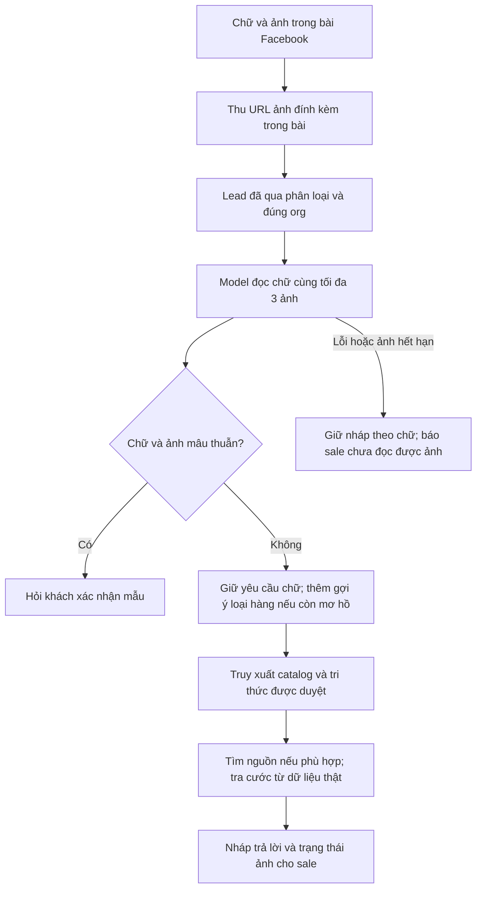

# Hiểu nội dung chữ và ảnh trước khi tạo gợi ý lead

## Trạng thái và phạm vi

Implemented local trong THG_tool worktree `feat/company-knowledge-foundation`,
nền `b2a3cf6d`; chưa commit, phát hành extension, deploy hoặc bật production.
Đường chính đã nối là bài quét từ Chrome Extension → crawl-result → lead event →
enrichment → Telegram. Bộ phân loại/điều kiện tạo lead vẫn dựa trên luồng cũ;
đây không phải chức năng tìm lead chỉ từ ảnh hoặc bỏ qua lọc nội dung ngắn.



## Sở hữu và ranh giới

| Component | Facade và trách nhiệm | Phần không sở hữu |
|---|---|---|
| Extension `platforms/facebook/crawl_images.js` | `THGCrawlImages.fromArticle`: chọn ảnh trong post container | Không tải ảnh, mở lightbox, lấy cookie hoặc tự thu ảnh bình luận |
| `internal/platform/facebook/media` | `URLs`: kiểm URL Facebook CDN, lọc trùng, tối đa 3 ảnh | Không gọi model, đọc DB hoặc quyết định sản phẩm |
| `internal/ai/visualcontext` | `Prompt`, `Parse`, `Context`: quan sát và phần chưa chắc, độc lập platform | Không xác minh supplier, tính giá/cước hoặc phân loại hàng vận chuyển |
| `internal/ai` | `AnalyzeLeadImages`: một request text + ảnh tới provider đã cấu hình | Không tải ảnh trên server, chọn nguồn hoặc gửi tin khách |
| Facebook service | `BuildLeadSuggestionWithImages`: xử lý mâu thuẫn, dùng hint có điều kiện và gọi luồng hiện có | Không ghi đè SKU/giá/khối lượng bằng suy đoán ảnh |
| Leadingest/Telegram | Truyền ảnh đúng event/org; hiển thị `ContextNote` riêng | Không sinh lại dữ kiện hoặc đưa note nội bộ vào lời nhắn khách |

## Contract tương thích

Connector item có thêm trường tùy chọn `image_urls: string[]`; extension cũ vẫn
được nhận nếu không có trường này. `leadingest.Input` và `LeadEvent` giữ danh sách
ảnh cùng bài/org. Khi phát event, chỉ giữ tối đa 3 URL hợp lệ và tạo slice riêng.
Không đổi schema DB. Các URL ảnh chỉ sống trong enrichment/event hiện tại;
không lưu media lâu dài hoặc bảo đảm replay từ DB. Payload CRM vẫn ánh xạ các
trường đã có; note ảnh và signed URL không tự thêm vào contract CRM.

Worker notifier cũng nhận `ContextNote` và có thể gọi nhánh ảnh khi event mang
ảnh. Producer legacy CDP/Stateful chưa được bổ sung thu ảnh ở thay đổi này;
không coi việc wiring worker có sẵn là bằng chứng các producer đó phát được ảnh.

## Chọn đúng ảnh

Collector chỉ quan sát các ảnh có liên kết photo trong container của bài, lọc
avatar nhỏ, header, comment/nested article và URL ngoài Facebook CDN. Ảnh cần có
kích thước đang hiển thị ít nhất 120×120; không dùng kích thước file gốc để nhầm
avatar chất lượng cao thành ảnh sản phẩm. Danh sách script manifest và fallback
reinjection đã được cập nhật cùng thứ tự.

Ảnh được lấy là ảnh đang render trong bài gốc, không bảo đảm độ phân giải gốc
cao nhất. Selector Facebook có thể thay đổi và chưa được xác minh trên Facebook
live trong lượt này. Ảnh bị bỏ qua hoặc URL hết hạn phải để thiếu bằng chứng;
không thay bằng ảnh catalog, avatar hay preview Telegram.

Server chỉ chấp nhận HTTPS `fbcdn.net`/`fbsbx.com` hoặc subdomain thực, không
userinfo/port/fragment; tối đa 4096 ký tự/URL. Signed query được giữ để provider
có thể đọc ảnh; không ghi URL hoặc lỗi provider thô vào log/Telegram. Server
không fetch ảnh, không forward cookie đăng nhập hay theo redirect riêng.

## Kết quả model và cách dùng

Một request chứa text và ảnh cùng nhau. Mặc định dùng comment provider hiện có;
override riêng `LEAD_MODEL_*` được mô tả trong [Lead model pipeline](LEAD_MODEL_PIPELINE.md).
Nếu bật `LEAD_CONTEXT_ANALYSIS_ENABLED`, runtime dùng phân tích nhu cầu chữ/ảnh
thống nhất thay cho nhánh chỉ phân tích ảnh. Không tự đổi model. Nhánh chỉ ảnh
có đầu ra JSON gồm đúng bốn trường:

- `product`: loại hàng chung, tối đa 8 từ, chỉ chữ/khoảng trắng/dấu nối; để trống nếu không rõ.
- `observations`: tối đa 5 quan sát trực tiếp, có thể nhắc nhãn/model đọc rõ nhưng vẫn chưa xác minh.
- `uncertainties`: tối đa 5 chi tiết chưa chắc hoặc không đọc được.
- `text_image_conflict`: cần hỏi lại khi bằng chứng ảnh và yêu cầu chữ có điểm mâu thuẫn.

Parse từ chối field thiếu/null, schema lạ, query quá dài, URL trong quan sát,
ký tự điều khiển và claim sản phẩm/mâu thuẫn không có quan sát đi kèm. Prompt
đánh dấu cả chữ trong bài và chữ trên ảnh là dữ liệu, không phải chỉ dẫn cho AI.
Ảnh minh họa kho/hàng không tự tạo mâu thuẫn với yêu cầu vận chuyển/kho.

Chỉ thêm loại hàng ảnh làm hint tìm kiếm khi chữ chưa có query sản phẩm, chưa
có link 1688/Taobao và có nhu cầu phù hợp. Không đổi hướng bài chỉ hỏi kho/ship
hoặc đang chào bán. Text gốc được giữ riêng cho model viết câu; hint không sửa
số lượng, nơi nhận, yêu cầu in hoặc permalink của khách. Listing tìm theo hint
vẫn là mẫu tương tự, cần sale đối chiếu ảnh/mã; không phải visual reverse search
hay xác nhận cùng SKU. Nhu cầu rõ trong chữ/link khách đã gửi được ưu tiên.

Không lấy giá, trọng lượng, xuất xứ, chất liệu bên trong, tồn kho hoặc khả năng
chạy line từ vẻ ngoài/nhãn ảnh. Giá và cước tiếp tục chỉ lấy từ nguồn đã xác minh.
Thông tin nhìn thấy là quan sát chưa xác minh, không phải nguồn chuẩn kinh doanh.

Mâu thuẫn → chưa tìm nguồn/báo giá, hỏi xác nhận. Model lỗi/timeout/không hỗ trợ
ảnh → giữ luồng text. Bài nhắc ảnh nhưng không có URL gốc hợp lệ → thông báo rõ
cho sale. Có thêm một dòng `Ngữ cảnh ảnh` trong Telegram; nháp gửi khách vẫn
tách riêng, không lộ lỗi kỹ thuật hoặc URL có chữ ký.

## Bật và thử

Mặc định `LEAD_IMAGE_CONTEXT_ENABLED=false`; còn cần `LEAD_SUGGESTION_ENABLED`,
org allowlist và provider hợp lệ. Có ảnh thì thêm tối đa một request perception,
deadline 5 giây, không retry; vẫn nằm trong timeout/concurrency tổng của runner.
Cần đo độ trễ thật trước khi điều chỉnh timeout runner. Extension cũng phải được
build/reload từ source mới; chỉ deploy backend không giúp extension cũ gửi ảnh.

Thử riêng phần perception bằng nội dung test được phép dùng:

```powershell
go run ./cmd/company_knowledge_preview -live-image-context -env-file tmp/company-knowledge-model/.env -query "Need this model, 100 pcs to the US" -image-url "https://scontent.example.fbcdn.net/authorized-test-photo.jpg"
```

URL trong ví dụ là placeholder, không phải ảnh dùng được. Công cụ chỉ in kết quả
quan sát model ở trạng thái chưa review, không in URL ảnh/key và không tìm nguồn,
gửi Telegram/Facebook hay ghi DB. Chưa có credential local nên chưa có kết quả
model thật; cần ảnh gốc được phép dùng, còn truy cập được và model hỗ trợ ảnh.
Giao thức text + `image_url` theo [OpenAI Docs về image inputs](https://developers.openai.com/api/docs/guides/images-vision).

Rollback: tắt `LEAD_IMAGE_CONTEXT_ENABLED`, giữ luồng text. Không có migration
hoặc thay đổi CRM cần rollback. Nhóm kiểm thử chính: DOM selector/manifest sync,
URL filtering, parse JSON, text+ảnh request, image→query→supplier, conflict,
provider failure, image missing, event association, Telegram note và CRM contract.
Các test dùng DOM/HTTP giả lập không chứng minh chất lượng nhận diện ảnh thật.
