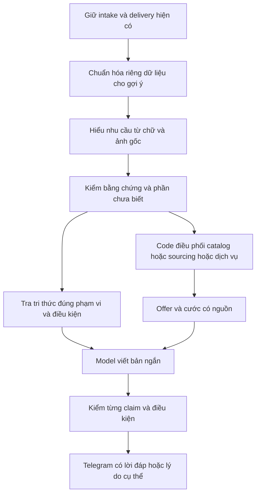

# Rà soát chất lượng gợi ý trả lời lead

## Cách đọc và cập nhật sau nghiên cứu

Đây là bản lưu nghiên cứu tại `0a85e36d`, trước các bản sửa tiếp theo trong
ngày 21/10/2026. Các mục bên dưới phần cập nhật này mô tả **snapshot lịch sử**;
không dùng những câu “chưa triển khai” hoặc kết quả probe đỏ ở đó để kết luận
trạng thái production hiện tại. Luồng đang dùng được duy trì tại
[LEAD_MODEL_PIPELINE.md](LEAD_MODEL_PIPELINE.md).

Đối chiếu bổ sung tới `main@5303dd6f3b919e7a4316479bec8ef85e6b00b37a`:

| Phát hiện / hạng mục | Trạng thái sau nghiên cứu | Giới hạn bằng chứng |
|---|---|---|
| Q01: header admin/moderator lẫn vào body | Đã sửa và có regression trong [PR #290](https://github.com/CONG-TY-TNHH-QU-C-ANH-GLOBAL/THG_tool/pull/290) | Không phải chứng minh mọi hình dạng DOM đã được hỗ trợ |
| Q02: cụm `we offer` chặn bài có nhu cầu thật trước model | Đã bỏ precheck đó trong nhánh phân tích, [PR #290](https://github.com/CONG-TY-TNHH-QU-C-ANH-GLOBAL/THG_tool/pull/290) | Model vẫn có thể phân loại sai; không đổi điều kiện intake |
| Q03: bằng chứng nhu cầu chỉ nằm trong ảnh | Thêm contract trích dẫn gắn chỉ số ảnh và kiểm số ảnh thực trong [PR #291](https://github.com/CONG-TY-TNHH-QU-C-ANH-GLOBAL/THG_tool/pull/291) | Probe cũ thiếu bằng chứng có chỉ số vẫn phải bị từ chối; chưa chứng minh thu nhận bài chỉ có ảnh hay khả năng vision thực tế |
| Q04: FAQ ghim không liên quan | Consumer cấp facts cho lời đáp loại kết quả không có text match, [PR #290](https://github.com/CONG-TY-TNHH-QU-C-ANH-GLOBAL/THG_tool/pull/290) | Không đổi contract pin của searcher dùng chung; không coi probe global cũ là regression phải xanh |
| Giữ chất liệu khi sourcing | Đã sửa truy vấn/kiểm khớp chất liệu trong [PR #292](https://github.com/CONG-TY-TNHH-QU-C-ANH-GLOBAL/THG_tool/pull/292) | Không phải xác minh SKU bằng ảnh |
| Tám public fact | Owner duyệt riêng; đã nhập và kiểm retrievability qua [PR #293](https://github.com/CONG-TY-TNHH-QU-C-ANH-GLOBAL/THG_tool/pull/293) và [PR #294](https://github.com/CONG-TY-TNHH-QU-C-ANH-GLOBAL/THG_tool/pull/294) | Toàn bộ pack 92 mục vẫn chưa được duyệt/nhập; không mở rộng giá, SLA, đền bù hoặc khả năng nhận hàng |
| Trả lời câu hỏi quy trình trước khi hỏi thêm | Bổ sung prompt trong [PR #295](https://github.com/CONG-TY-TNHH-QU-C-ANH-GLOBAL/THG_tool/pull/295), có thử model thật trên dữ liệu chữ tổng hợp | Ba draft và một fallback chưa đủ thành benchmark; case quy trình vẫn có ghi chú nhu cầu chưa rõ |
| Theo dõi đường đi ảnh | [PR #296](https://github.com/CONG-TY-TNHH-QU-C-ANH-GLOBAL/THG_tool/pull/296) thêm số tham chiếu ảnh và mã trạng thái có kiểm redaction | Số ảnh đưa vào một lần thử không chứng minh provider nhận được hoặc nhận diện đúng |
| Bình luận có POD branding làm lệch caption fulfillment | Đã tái hiện và sửa ranh giới count-plus-expanded-replies, hỗ trợ cách viết `fullfill`, [PR #297](https://github.com/CONG-TY-TNHH-QU-C-ANH-GLOBAL/THG_tool/pull/297) | Không thay raw excerpt, intake hay số bài về Telegram; chưa chứng minh chất lượng trên lead mới sau deploy |

Bằng chứng runtime ngày 21/10 (giờ Việt Nam): deploy
[`39591388328`](https://github.com/CONG-TY-TNHH-QU-C-ANH-GLOBAL/THG_tool/actions/runs/39591388328)
có backup, scraper/worker/frontend healthy lúc 18:24. Diagnostic chỉ đọc
[`39591823144`](https://github.com/CONG-TY-TNHH-QU-C-ANH-GLOBAL/THG_tool/actions/runs/39591823144)
xác nhận hai binary đang chạy đúng `5303dd6f`, phân tích chữ/ảnh bật và đúng
scope. Probe plan-status có một lần lỗi upstream; kiểm tra lặp có giới hạn
[`39592072432`](https://github.com/CONG-TY-TNHH-QU-C-ANH-GLOBAL/THG_tool/actions/runs/39592072432)
báo ready lúc 18:27. Không suy ra số dư sourcing từ readiness. Hai cửa sổ
20 phút đều chưa có suggestion event mới, nên chưa có đánh giá chất lượng
ảnh/lời đáp sau bản phát hành này.

[Manifest tám mục](../business/company-knowledge/release-review-2026-10-21.json)
giữ nguyên nội dung lịch sử, kể cả metadata pending/not_loaded. Phê duyệt và
việc nhập sau đó được ghi riêng trong
[runbook phát hành](COMPANY_KNOWLEDGE_RELEASE.md); không sửa manifest để làm
thay đổi nội dung đã được owner duyệt và hash mà lệnh release kiểm tra.

[36 ca](lead-reply-quality/cases.json) vẫn là **đề xuất chưa thực thi thành bộ**;
các regression riêng đã pass không đồng nghĩa 36 ca này đạt. Ba file `.go.txt`
là bằng chứng probe lịch sử, không được nạp vào CI hoặc phục hồi mù vào HEAD
mới. Đặc biệt không nới kiểm evidence ảnh hoặc sửa searcher chung chỉ để làm
probe cũ xanh.

Phần cần kiểm chứng tiếp: ảnh gốc từ extension đang cài tới model; chất lượng
lời đáp/link trên lead mới; hạn mức sourcing thực tế; benchmark holdout của
retrieval/wording. Các đề xuất schema nhu cầu nhiều intent, semantic retrieval,
structured DOM và taxonomy trong phần lịch sử chưa được triển khai đầy đủ.

---

## Kết luận và phạm vi

Mục tiêu là giúp sale nhận được lời đáp đúng nhu cầu, có căn cứ và ngắn gọn.
Việc sửa mất lượt khi quá tải đã có bằng chứng triển khai; chất lượng hiểu bài,
chọn tri thức và diễn đạt vẫn cần đo riêng. Thay đổi prompt đơn lẻ chưa giải
quyết được các bước có thể mất hoặc hiểu sai dữ kiện ở trước và sau model.

Snapshot rà soát gốc: `THG_tool@0a85e36d12e41306d162cf5962f10d974e862ffd`,
trùng fetched `origin/main` tại thời điểm nghiên cứu đầu ngày 21/10. Bản rà soát gốc không sửa runtime, nhập
tri thức hay triển khai. Kết quả production của #289 ở
[chẩn đoán](LEAD_SUGGESTION_DIAGNOSTIC.md); contract hiện tại ở
[luồng model](LEAD_MODEL_PIPELINE.md) và [sourcing](SUPPLIER_SOURCING.md).

## Yêu cầu đã chốt

| Yêu cầu | Điều kiện để đạt |
|---|---|
| Giữ bài quét về Telegram | Giữ nguyên quyết định intake/delivery hiện có; phân tích gợi ý không thành bộ chặn bài mới |
| Không dùng từ khóa làm cửa vào gợi ý | Bài đã vào luồng gợi ý phải được xem ngữ cảnh; không bỏ lượt chỉ vì thiếu một cụm chữ |
| POD ưu tiên công ty | Có nhu cầu in/cá nhân hóa và catalog thực sự khớp; không thay stocking bằng áo chỉ vì cùng POD |
| POD thiếu mẫu | Được gợi ý nguồn sàn thay thế, ghi rõ còn cần xác nhận khả năng in |
| Dropship | Nguồn 1688/Taobao có thật, link đúng listing; giá nguồn và MOQ chỉ khi có dữ kiện |
| Yêu cầu nguồn châu Âu | Có thể đưa nguồn Trung Quốc làm phương án thay thế và phải nói rõ khác yêu cầu xuất xứ |
| Cước | Chọn đúng bảng/tuyến theo mục đích và dữ kiện; thiếu dữ kiện thì giữ nguồn hàng, hỏi phần thiếu |
| Thiếu nguồn | Không bịa link/giá; hỏi thông tin cần thiết nếu có nhu cầu thực sự |
| Bài không có nhu cầu phù hợp | Sale thấy lý do; không ép tạo lời chào bán |
| Lỗi xử lý | Phân biệt với không có nhu cầu và tìm không thấy hàng |
| Lời đáp | Đúng ngôn ngữ, khoảng 2–3 câu ngắn, hỏi phần chưa biết, không đọc lại brochure |

Quy tắc POD/Dropship phụ thuộc nhu cầu. Không luân phiên cứng theo thứ tự bài.
Private label hoặc nhắc tới Amazon không tự chứng minh có yêu cầu in logo.
Giá nguồn được phép hiện trong nhóm nội bộ theo xác nhận người dùng; quyết định
này không thay quyền xem cost trong các màn hình CRM khác.

## Luồng thực tế tại snapshot

```text
Extension đọc article DOM, gom chữ và tối đa 3 URL ảnh gốc
  → crawl-result → ingest/scoring/dedupe hiện có
  → thông báo lead đủ điều kiện theo luồng cũ
  → runner có hàng chờ giới hạn trong org được bật phân tích
  → leadPostBody tách một số header/UI/comment bằng regex
  → kiểm tra cụm quảng cáo dịch vụ trước model
  → model đọc chữ và URL ảnh, trả một intent + category + bằng chứng
  → code dựng lại truy vấn, chọn catalog/nguồn sàn/dịch vụ
  → code gọi nguồn hàng; có đủ điều kiện mới gọi CRM rate router
  → truy xuất tri thức public đã duyệt để model sửa lời văn
  → code kiểm link/số/nhãn và giữ bản dự phòng nếu không chấp nhận
  → snapshot CRM và tin Telegram
```

Model chưa tự quyết định gọi tool tùy ý. Các nhánh công cụ do code điều phối.
`Context` chỉ chứa một intent, category, text evidence, missing fields và visual.
Số lượng/đích giao vẫn bị đọc lại từ chữ bằng parser; chưa có bản nhu cầu thống
nhất có nguồn cho mọi bước. Shipping/warehouse đi thẳng sang lời hỏi dịch vụ.

Hai composition root dùng `knowledgeRuntime.NewBuilder`, tức
`hybrid-v2-multilingual`: xếp theo chữ, boost, pin và recency. Đây chưa phải kết
hợp tìm theo chữ với vector. Code pgvector, fallback và RRF có sẵn nhưng chưa
được nối vào luồng này. Chỉ đổi tên constructor không chứng minh đã có vector.

Tri thức công ty chỉ tham gia bước sửa lời văn khi đã có bản dự phòng không
rỗng. Bộ 92 mục trong Git vẫn pending/not_loaded; chưa thể coi hệ thống đang tư
vấn từ toàn bộ kho đó. Chi tiết approval/public projection ở
[hướng dẫn tích hợp](../business/company-knowledge/INTEGRATION.md).

92 mục gồm 14 public_source_checked, 5 task_owner_confirmed,
3 implementation_checked, 33 legacy_source_checked, 29 proposed_guidance,
6 proposed_example và 2 needs_confirmation. Đây là mức xác minh của nội dung,
không phải 92 chính sách hiện hành đã duyệt. Đợt import đầu cần chọn facts đủ
nguồn và phạm vi, không chuyển cả pack thành approved để model có dữ liệu.

## Những điểm đã tái hiện được

Bốn phép thử dùng dữ liệu tổng hợp, fake HTTP provider và store trong bộ nhớ.
Chạy trên source snapshot ở trên; không gọi model/Elim thật, không gửi Telegram.
Các probe là yêu cầu đầu ra mong muốn và đều **đỏ**, không phải test pass.
Bản sao ở [thư mục bằng chứng](lead-reply-quality/); chúng không nằm trong Go
package hoặc CI, để không đưa bốn test đang đỏ vào suite chung.

| Mã | Kết quả thực thi | Ý nghĩa và hướng xử lý |
|---|---|---|
| Q01 | Header `Facebook Sample Author Quản trị viên · 1 ngày trước ·` còn trong `leadPostBody` | Regex hiện chưa hỗ trợ role trước timestamp. Ưu tiên body từ DOM có cấu trúc; bổ sung parser legacy bằng regression fixtures |
| Q02 | `We offer handmade products and need a shipping agent from China to the US.`: model calls=0, analysis=offer_review | Cụm `we offer` làm bài có nhu cầu mua dịch vụ bị bỏ trước model. Bỏ quyết định chặn dựa trên cụm chữ trong nhánh phân tích; giữ fallback khi provider lỗi |
| Q03 | `post=""`, có ảnh và observations mô tả dòng yêu cầu: `Parse` từ chối | Contract bắt bằng chứng nguyên văn trong text cho mọi intent rõ. Muốn hỗ trợ nhu cầu chỉ viết trong ảnh cần evidence có nguồn ảnh; không chỉ nới parser cho mọi ảnh sản phẩm |
| Q04 | Query `ocean freight` trả FAQ ghim `Custom mugs`, TextMatch=0 | Pin là ưu tiên của searcher chung, chưa phải chứng minh liên quan. Nhánh cấp facts cho lời đáp cần kiểm liên quan riêng; không tự đổi hành vi pin toàn hệ thống |

Lệnh thực thi:

```powershell
go test ./internal/services/facebook ./internal/ai/leadcontext ./internal/workspace_knowledge/retrieval/hybrid -run '^TestResearch' -count=1 -timeout=90s
```

Probe được tạm đặt tại `quality_research_probe_test.go` ở từng package, chạy rồi
gỡ. Tên và nội dung giữ nguyên trong các file `.go.txt`; chỉ phục hồi vào một
worktree sạch dành cho nghiên cứu. Dùng Go 1.26.8 và cache cục bộ. Q02 sử dụng
HTTP loopback. Không dùng kết quả này để kết luận mọi tin trống trong production
đều mắc Q01–Q04.

## Khoảng trống đã thấy trong source và phần cần đo

| Ưu tiên | Vấn đề | Bằng chứng hoặc giới hạn | Việc xử lý và kiểm chứng |
|---|---|---|---|
| P0 | Hai cách hiểu cùng nhu cầu | `lead_context.go` phân tích rồi `lead_suggestion_resolve.go`/`lead_suggestion_match.go` đọc lại chữ | Tạo bản nhu cầu có evidence; tool nhận field đã kiểm thay vì tự parse lại toàn bài |
| P0 | Bài có text + ảnh chưa được chứng minh chạy thật | Code chuyển URL; bản extension đang cài và provider tải ảnh thành công chưa có bằng chứng E2E | Kiểm bản extension, ảnh gốc hợp lệ, có/không observations, phản hồi trên bài mới |
| P0 | Text thiếu và comment lẫn vào nhu cầu | Extension lấy cả article và ép whitespace; parser hỗ trợ một số hình dạng | Tách post body tại adapter; giữ raw content cho luồng hiện tại; completeness rõ ràng |
| P0 | Kho tri thức chưa phục vụ đầy đủ luồng thật | Pack pending; public retrieval nằm ở bước wording | Tách public facts đủ nguồn để review/import trước; giữ phần chưa xác nhận ngoài lời đáp |
| P0 | Giá/cước có thể đúng số nhưng sai vai trò | Guard kiểm chuỗi/số, không chứng minh ngữ nghĩa | Gắn từng claim với nguồn, đơn vị, variant, tier, parcel/lot và thời điểm |
| P1 | Một intent bỏ sót nhu cầu phối hợp | Schema chỉ một chuỗi intent | Primary + secondary needs: tìm hàng kèm in và vận chuyển; không nhân đôi truy vấn vô ích |
| P1 | Tìm theo ý nghĩa chưa nối | Hai root chọn lexical builder | Benchmark semantic và rerank trên kho đã được phép dùng, giữ ACL trước truy xuất |
| P1 | Pool truy xuất có giới hạn trước ranking | Product K=6 → pool 60; public K=12 → pool 120 | Đo candidate recall theo quy mô/source ordering; không tăng pool vô hạn |
| P1 | Hỏi lại dữ kiện đã có | Missing fields của model chưa là contract tool/fallback | Mọi câu hỏi đọc cùng bản nhu cầu; kiểm mẫu có đủ và thiếu thông tin |
| P1 | Lời văn sửa đúng bị guard chặn | `safeKnowledgeReply` chỉ cho số trong post/product name | Facts kiểu số cần claim có kiểu; không mở cửa mọi số chỉ vì có trong đoạn tri thức |
| P1 | Router cước chưa bao phủ mọi yêu cầu | Caller hiện nhận dạng US/AE/GB; CN cố định, standard chỉ khi apparel phù hợp; giới hạn weight | Lập bảng coverage với CRM owner. Unsupported/unknown không đồng nghĩa không có tuyến trên website |
| P1 | Một listing chưa chắc một giá đúng | Màu/size/pack/tier/đơn vị có thể khác | Giữ variant và điều kiện của giá; không coi giá thấp nhất là giá 300 hộp |
| P1 | Template được dùng nhưng không biết lý do cụ thể | Có final analysis/wording code, chưa thấy timing chi tiết từng bước | Thêm reason theo stage, queue time, duration, số hit, validator rejection code; không log nội dung/key |
| P1 | Queue không durable | #289 dùng hàng chờ trong bộ nhớ, tối đa 32/60s | Đo restart/expiry/load trước khi quyết định durable job; thêm replay cần idempotency riêng |
| P2 | Trạng thái Telegram gây hiểu nhầm | `Sẵn sàng xử lý` không phải kết luận có nhu cầu mua | Hiện riêng kết quả phân tích/gợi ý, giữ nguyên delivery |
| P2 | Trôi chất lượng theo phiên bản | Provider/model/config/content/index đều có thể đổi | Gắn phiên bản và bộ ca giữ riêng; so trước/sau và có rollback |

P0 là thứ tự cần giải quyết trước khi tuyên bố đạt chất lượng, không phải xác
nhận đã xảy ra sự cố cho từng hàng. Incident đã có runtime evidence là runner
busy ở một bài lịch sử; xem tài liệu chẩn đoán. Các giả thuyết như model chậm ở
stage nào phải đo, không suy từ một ảnh Telegram.

## Luồng đề xuất và hợp đồng dữ kiện



### Dữ liệu đầu vào

Giữ nguyên raw content phục vụ intake/delivery hiện tại. Bổ sung dữ liệu phục vụ
gợi ý theo contract additive: body riêng, metadata tác giả/thời gian, ảnh gốc,
phần trích từ comment tách biệt, phiên bản extractor và mức đầy đủ của bài.
Không mở rộng nội dung được thu thập sang comment/ảnh không thuộc bài.

DOM adapter thuộc `local-connector-extension/platforms/facebook`; `content/`
giữ vai trò bridge. Chỉ mở nội dung bài bằng thao tác được hỗ trợ, trong phiên
Chrome đang được người dùng quan sát. Không lấy ảnh preview hoặc dùng ảnh xe tải
minh họa để thay đổi sản phẩm khách đang hỏi. Thiếu dữ liệu không được giả như
đã đọc đầy đủ; ảnh hết hạn hoặc bài cắt ngắn chuyển về clarification/review.

Giữ payload cũ hoạt động. Server hỗ trợ field mới trước, extension phát sau.
Bản server build xong không chứng minh người quét đã cài extension mới.

### Bản nhu cầu dùng chung

AI đề xuất các nhu cầu, sản phẩm, biến thể/ràng buộc, số lượng và đơn vị, kỳ nhu
cầu, xuất xứ mong muốn, nơi giao, yêu cầu in và dữ kiện còn thiếu. Mỗi field có
nguồn: span trong body hoặc ảnh số mấy/observations nào. Code xác minh span,
kiểu dữ liệu, tính nhất quán và mục đích sử dụng trước khi gọi tool.

Phân biệt supplier location, product origin, ship-from và destination; tách
monthly demand khỏi số lượng trong một kiện/lô. Bài có hai đích hoặc hai loại
hàng không lấy số đầu tiên làm báo giá chung. Model confidence tự khai không
đủ để xác nhận. Giá/khối lượng/khả năng nhận hàng không suy từ ngoại hình.

Evidence nguyên văn chỉ giúp tra lại, chưa chứng minh AI hiểu đúng. Bằng chứng
ảnh cần kiểm riêng; chữ trong ảnh vẫn là dữ liệu không đáng tin để ra lệnh.
Ảnh chỉ có sản phẩm mà không có nhu cầu không tự trở thành yêu cầu mua.

### Tri thức và lựa chọn công cụ

Truy xuất riêng sản phẩm và kiến thức doanh nghiệp. Lọc org, approval, audience,
source health và hiệu lực trước khi kết quả được cấp cho model. Chuẩn hóa các
truy vấn theo nhu cầu đã kiểm; giữ ràng buộc gốc, không tự nới xuất xứ/chất liệu.
Tìm kiếm theo nghĩa giúp tìm ứng viên; kiểm liên quan và điều kiện mới quyết
định đưa facts vào lời đáp. Tài liệu không phù hợp thì được phép trả rỗng.

Catalog là nguồn sản phẩm công ty; Pricing Hub → Elim là nguồn sàn; CRM rate
router là nguồn chọn/tính cước. Model không tự tính giá, chuyển tiền tệ hay chế
URL. Cước thiếu vẫn cho phép gợi ý sản phẩm có căn cứ. Cả ba bảng giá được leader
xác nhận là nguồn chuẩn, nhưng mỗi bảng có mục đích khác nhau; không nhét toàn
bộ bảng vào prompt rồi để model làm bộ tính giá.

Mỗi offer cần giữ listing/variant/đơn vị/price tier/MOQ/currency/thời điểm và
trạng thái tương tự hay link khách cung cấp. Link đúng không bảo đảm hàng còn
stock, đúng SKU thực tế hoặc nhà cung cấp nhận in. Mỗi shipping reference cần
tuyến, cargo, destination, weight basis, phụ phí/ngoại lệ, hiệu lực và phạm vi
parcel/lot. Tri thức tĩnh không thay giá/cước hiện hành.

### Tạo lời đáp và kết quả lỗi

Đầu vào model viết gồm nhu cầu đã kiểm, facts công khai liên quan và offer/cước
đã chọn. Lời đáp giải quyết điều khách hỏi trước, nhắc phương án có căn cứ và
chỉ hỏi bước tiếp theo. Thuộc tính chưa biết không được biến thành cam kết.

Kiểm claim có kiểu: tên sản phẩm, URL, amount+currency+unit+role, MOQ/tier,
xuất xứ, khả năng in, cước và điều kiện. So số đơn lẻ/substring không đủ.
Nếu wording bị loại, giữ bản có căn cứ cùng lý do nội bộ; không gọi sửa vô hạn.
Judge bằng AI chỉ là hỗ trợ đo, không thay kiểm link/số hoặc người duyệt mẫu.

Kết quả cần tách: draft_ready, needs_clarification, noncommercial,
needs_review, source_no_match, source_unavailable, model_unavailable,
processing_unavailable. Một số trạng thái đã có tên tương đương trong code;
đây là taxonomy đề xuất, chưa thay schema. Không dùng câu hỏi mua hàng chung để
che lỗi provider, hay gắn nhãn khách không có nhu cầu vì hết thời gian xử lý.

## Giải pháp tham khảo và lựa chọn có điều kiện

Đối chiếu nguồn chính thức ngày 21/10/2026. Bảng này là đánh giá kỹ thuật cho
THG; chưa cài, benchmark hoặc chọn một dịch vụ trả phí mới.

| Thành phần | Khả năng có thể dùng | Lựa chọn cho task |
|---|---|---|
| [Workflow routing của Anthropic](https://www.anthropic.com/research/building-effective-agents) | Phân biệt code workflow và agent tự điều phối | Giữ workflow rõ ràng: AI hiểu/viết, code kiểm và gọi tool. Đây là suy luận kiến trúc cho yêu cầu cố định của THG |
| [Haystack retrievers](https://docs.haystack.deepset.ai/docs/retrievers), [rankers](https://docs.haystack.deepset.ai/docs/choosing-the-right-ranker) | Sparse/dense, kết hợp kết quả, xếp lại ứng viên | Tham khảo cấu trúc; chưa có lý do chuyển runtime Go sang framework Python |
| [BGE M3](https://huggingface.co/BAAI/bge-m3), [FlagEmbedding reranker](https://github.com/FlagOpen/FlagEmbedding/blob/master/examples/inference/reranker/README.md) | Embedding đa ngôn ngữ và rerank query–passage | Ứng viên benchmark Việt/Anh/Trung; tên model và benchmark chung không bảo đảm tốt trên THG |
| [Text Embeddings Inference](https://github.com/huggingface/text-embeddings-inference) | Phục vụ embedding/reranking qua API | Chỉ cần nếu chọn host riêng; xác minh model/revision, CPU/GPU, latency và vận hành trước |
| [pgvector](https://github.com/pgvector/pgvector) | Tìm vector trong PostgreSQL | Repo đã có adapter. Phải kiểm retrieval plane thực có extension, index và embedder; SQLite local không tự có capability |
| [Ragas metrics](https://docs.ragas.io/en/latest/concepts/metrics/available_metrics/) | Context precision/recall, faithfulness, response relevancy | Dùng cho đánh giá ngoại tuyến khi có model được phép; giữ thêm rule checks và người đọc độc lập |

FlagEmbedding và model card BGE M3 hiện nêu MIT; TEI và Ragas có Apache 2.0 trong
LICENSE đã đọc. Trước tích hợp cần pin revision/license của đúng code và weights,
giới hạn network và không tải mã tùy ý chỉ vì là open source. Không bổ sung host
VLM mới trong vòng này; kiểm khả năng vision của provider được phép đang dùng.

Không yêu cầu bỏ mọi lexical search: yêu cầu đã chốt là bỏ keyword admission.
Lexical có thể là một nhánh tìm ứng viên cùng semantic, không làm cửa chặn bài.
RRF có sẵn cũng không phải kiểm chứng mức liên quan; pin và ngưỡng theo rank
không tự chứng minh một tài liệu hỗ trợ câu trả lời.

## Kế hoạch thực hiện và điểm dừng rõ ràng

| Đợt | Phạm vi và owner | Bằng chứng cần trước khi phát hành |
|---|---|---|
| 1 | THG_tool: bỏ precheck cụm quảng cáo trong nhánh AI; sửa input legacy và thêm body có cấu trúc additive | Q01/Q02 xanh; quảng cáo thuần vẫn không có pitch; các bài cũ vẫn tới Telegram như trước |
| 2 | THG_tool: contract nhu cầu có evidence chữ/ảnh, primary/secondary needs và tool routing | Q03 xanh với ảnh thực đủ bằng chứng; không lấy text trong comment hoặc tự tạo số/cước; giữ text-only fallback |
| 3 | Tri thức: public facts được review riêng, import org đúng phạm vi; retrieval liên quan | Q04 xanh tại consumer reply; pending/private không lọt; recall theo paraphrase và tiếng Việt/Anh tăng trên holdout |
| 4 | Sourcing/rate: field đã kiểm và claims có nguồn; chỉ sửa provider nếu contract thật sự cần | Exact link/variant/tier, China alternative, cargo/parcel/lot; consumer cũ vẫn tương thích |
| 5 | Wording và vận hành: đo lỗi từng stage, đánh giá model thật, rollout scoped | So trước/sau đạt rubric, không mất facts, có mẫu lead mới; có rollback cho code/config/knowledge/index |

Các đợt có thể chuẩn bị test song song về thời gian, nhưng merge/deploy theo
dependency. Không gộp schema migration, chuyển search plane và sửa extractor
thành một lần phát hành khó truy nguyên. Chưa có cơ sở cần thêm LangGraph,
GraphRAG, model host mới hoặc agent tự điều phối để giải quyết task này.

## Cách đo hoàn thành

1. Tạo bộ chuẩn có cả nhu cầu thật và bài ngoài phạm vi, ảnh phụ thuộc/ảnh minh
   họa/ảnh lỗi, Việt/Anh, đầy đủ/thiếu dữ kiện, nguồn chậm/hết quota và burst.
   [Bộ ca đề xuất](lead-reply-quality/cases.json) dùng tình huống tổng hợp,
   không sao chép nội dung hay danh tính khách. Mô tả ảnh chưa thay ảnh thật.
2. Tách bộ phát triển với holdout; không sửa prompt rồi tự chấm bằng đúng các
   ví dụ đã nhìn. Đọc độc lập các mẫu chưa thống nhất nhãn; không suy nhãn theo
   tác giả hoặc group. Bộ 24 ca retrieval hiện có chỉ là baseline riêng.
3. Đo từng bước: body sạch/đầy đủ, primary need, field chính xác, candidate
   recall, context relevance, đúng link/variant/giá/cước, số lần hỏi lại, độ tự
   nhiên, tỷ lệ fallback và thời gian hàng chờ/xử lý. Báo cả số mẫu/mẫu số và
   các nhóm lỗi; không gộp một điểm trung bình che lỗi báo giá.
4. Tiêu chí release đề xuất: 100% case bắt buộc về link/số/ACL/không bịa cam kết
   phải qua; 100% nhu cầu rõ trong bộ kiểm phải có draft hoặc lý do lỗi đúng;
   ít nhất 90% mẫu holdout được người đọc chấm đúng trọng tâm và dùng được sau
   sửa nhẹ. Đây là mục tiêu chưa đo, không phải số liệu chất lượng hiện tại.
5. Test đơn vị và fake provider trước; sau đó model thật trên dữ liệu tổng hợp
   với cấu hình công ty cho phép. So sánh cấu hình thực đang chạy; chưa biết
   model production thì không dùng model mặc định trong source để kết luận.
6. Production chỉ quan sát bài mới trong org đã bật. Không gửi synthetic lead,
   replay bài cũ hoặc tự post Facebook. Healthy services, CI xanh và bật flag
   không đủ để kết luận lời đáp đạt yêu cầu.

Ngưỡng chất lượng cần đi cùng phạm vi mẫu và người đánh giá; không phải cam kết
không có bug. Task chỉ chốt khi cả tính đúng đắn và đầu ra thực tế có bằng chứng.

## Kiểm tra vòng nghiên cứu này

- Git fetch xác nhận main chưa có thay đổi sau #289 tại lúc rà soát.
- Bốn probe chạy và đỏ như bảng Q01–Q04; bản sao giữ để tái hiện.
- Probe tạm đã gỡ khỏi package; không thay source runtime hoặc cấu hình.
- Baseline sau khi gỡ probe: năm package đều pass với lệnh sau. Đây không phải
  đánh giá model thật hoặc xác nhận đạt bộ 36 ca mới.

  ```text
  go test ./internal/services/facebook ./internal/ai/leadcontext ./internal/workspace_knowledge/retrieval/hybrid ./internal/workspace_knowledge/runtime ./internal/notifications -count=1 -timeout=120s
  ```

- `bash scripts/check_docs_governance.sh` pass; fixture JSON có 36 ID duy nhất.
- `node scripts/knowledge/build-company-knowledge.mjs --check` tại worktree
  Windows dừng ở `Stale generated file topics/company.md`. Git blob dùng LF,
  checkout dùng CRLF, và hai bản khớp sau chuẩn hóa line ending. Chạy lại đúng
  generator trên bản sao pack riêng chỉ chuẩn hóa Markdown CRLF → LF đã pass:
  92 mục, 10 nhóm, 38 nguồn, 21 ví dụ, 15 câu hỏi mở, runtime=not_loaded. Không
  sửa pack gốc hoặc generator để giấu kết quả kiểm tra ban đầu.
- Các repo khác không chỉnh sửa; Pricing Hub local root cũ không được dùng làm
  bằng chứng production. Contract cước được xác định từ consumer THG_tool gọi
  CRM; mở rộng route cần đối chiếu đúng provider revision trước khi sửa.
